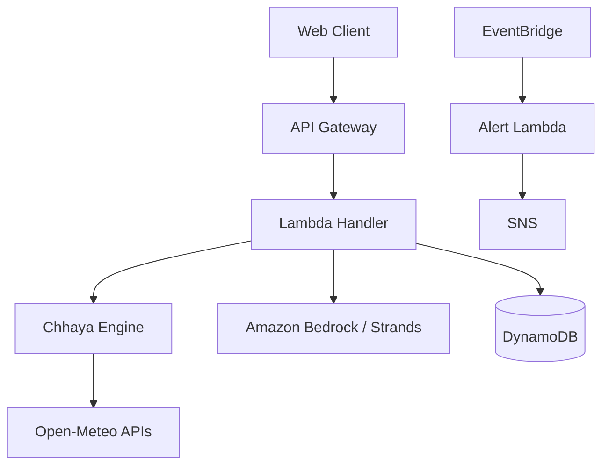

# Architecture

- Python 3.11 target.
- Monorepo containing engine, backend, and web frontend.
- AWS SAM for infrastructure (template.yaml)
- Services: Lambda, API Gateway (HTTP API), DynamoDB, EventBridge, SNS, Bedrock, CloudWatch.
- Local mode using `moto` and fixtures.

