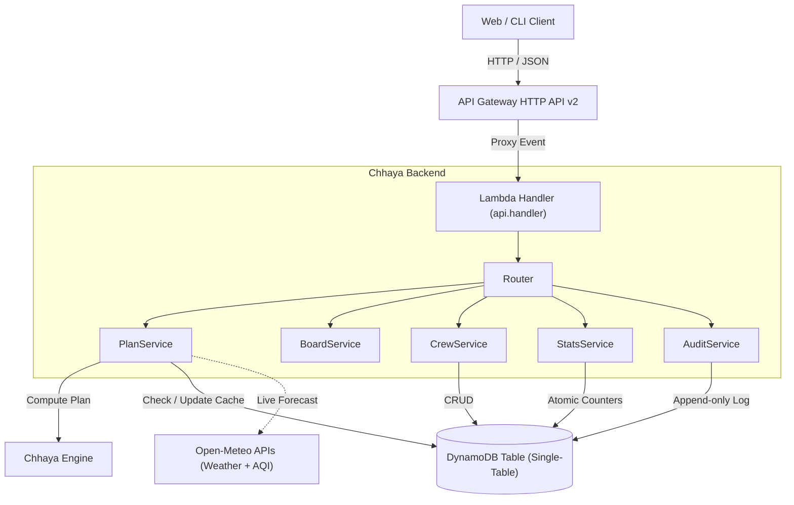

# Architecture

## Overview
Chhaya is designed as a serverless, decoupled microservice built on AWS Lambda, API Gateway HTTP API v2, and Amazon DynamoDB, with zero external runtime dependencies beyond the Python 3.11 standard library, `boto3`, and the pure-Python `chhaya_engine`.

## High-Level Data Flow

## DynamoDB Single-Table Design

The table uses `PAY_PER_REQUEST` billing with partition key `pk` (String) and sort key `sk` (String), plus a TTL attribute `ttl` (Number).

### Access Patterns & Key Schema

| Entity | `pk` | `sk` | TTL | Description |
| :--- | :--- | :--- | :--- | :--- |
| **Readings Cache** | `READINGS#<lat_lon>` | `READINGS` | 30 mins (`now + 1800`) | Cached hourly weather/AQI readings JSON. Key formatted as `f"{lat:.2f}_{lon:.2f}"`. |
| **Crew Profile** | `CREW#<id>` | `CREW` | None | Anonymous group profile (`name`, `city_id`, `job_type`, `workload`, `size`). |
| **Global Stats** | `STATS#GLOBAL` | `STATS` | None | Atomic counters (`plans_generated`, `hours_flagged`, `lead_time_sum`, `lead_time_count`). |
| **Audit Event** | `AUDIT#<yyyy-mm-dd>` | `<iso_timestamp>#<id>` | 30 days (`now + 30d`) | Append-only anonymized event log (`event_type`, `details_json`). Strictly no PII. |

## Endpoints

- `GET /health` - Health check, runtime metadata, data mode, and version.
- `GET /cities` - Seeded Indian cities with coordinates.
- `POST /plan` - Validates India bounding box and computes 24-hour heat/air day plan with recommended blocks.
- `GET /board` - Multi-city, multi-job risk matrix for the live Risk Board.
- `GET /stats` - Real-time metrics on plans generated, flagged hours, and average lead time.
- `GET /audit` - Append-only system audit log (no personal data).
- `GET /crews` - List registered anonymous crews.
- `POST /crews` - Create crew profile (protected by `X-Chhaya-Passcode`).
- `GET /crews/{id}` - Fetch crew details with live plan summary.
- `DELETE /crews/{id}` - Remove crew profile (protected by `X-Chhaya-Passcode`).

